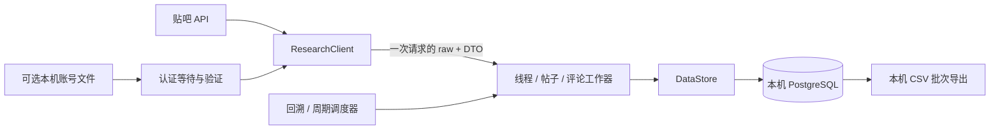

# 架构与数据边界

本文对应当前实现。普通 CREATE 12 页、隔离恢复迁移、有限详情排空、字段生产入库和定向页面核验已有实测。最新全库 CSV 有 89 个主题、2,173 条一级回复、77 条楼中楼；详情子范围仍有未完成项，不能把列表页数、单 scope 完成或 CSV 一致性等同于全吧完整。

## 请求与数据流



应用由 `main.py` 创建配置、Container、PostgreSQL 会话工厂、调度器和分通道工作器。`src/research/client.py` 在一次 API 调用中保留 aiotieba raw 响应与 tiebameow DTO，供基础 ORM 和项目研究扩展共同使用。`DataStore` 保存基础表、研究表、checkpoint 和质量状态。

默认 `consumer.transport = "none"`、`cache.backend = "memory"`。本机运行只需要 PostgreSQL 和访问贴吧 API 的网络；不需要 Docker、Redis、TimescaleDB 或远程数据库。只有用户主动改用 Redis/WebSocket 消费者或 Redis 缓存时才需要相应服务。

研究客户端的全局请求预算默认 `global_rps = 0.2`。通过当前 Container 创建的 `ResearchClient` 请求共用此间隔，包含用户吧内资料查询。`threads_rps`、`posts_rps` 和 `comments_rps` 另有限制各自接口。该配置不是贴吧给出的官方限额，也不限制其他程序自行发出的请求。

## 回溯、周期监控与恢复

- `backfill` 对普通主题和精华主题各开一条列表流，从第 1 页开始，使用 `ThreadSortType.CREATE`。每条流一次只请求一页，收到工作器 ACK 后再推进；多贴吧与普通/精华流轮转处理。
- `periodic` 监控首页，使用 `ThreadSortType.REPLY`。
- `hybrid` 同时运行周期首页监控和一轮 CREATE 回溯。REPLY 首页不会充当 CREATE 流的第 1 页。
- `[tieba] max_backfill_pages = 0` 表示回溯流没有配置页数上限。正数限制每条列表流在本次运行中读取的页数；达到上限时记录 `paused_limit`。
- 回溯会检查页码、空页元数据、页内和跨页创建时间顺序、重复页指纹及服务端 `has_more`。这些检查失败时该流记录失败/未完成状态，不把异常空页当作正常终止页。

每个研究 run 由 `research_run` 记录；`research_checkpoint` 按 run、任务键和页码保存列表、帖子详情和评论页状态、尝试次数、下一页、服务端报告数、游标、错误及 scope 状态。论坛范围必须与恢复目标兼容。`--resume` 选择最新可恢复 run；`--run-id` 可指定精确 run，且必须与 `--resume` 同用。

列表流恢复时，最近一个成功但仍有后续页的非终止页会重放一次，以吸收顶部删帖或更新造成的页码位移。内容扩展按实体 ID 幂等写入。帖子与评论详情从成功页之后继续，失败或未完成页可重试。一次本机真实主入口演练以 `max_backfill_pages = 1` 恢复同一 run，重放普通 CREATE 流第 1 页并推进到第 2 页后收到 SIGINT；run 状态保留为 `interrupted`。该演练只验证列表 checkpoint 的重放与推进，不代表详情 scope 已完成，也不证明完整回溯、IDE GUI 停止或长页现场恢复。

### 详情任务代际、原子提交与质量状态

`research_task_scope` 以 `(run_id, logical_task_key)` 保存每个详情扫描的当前代际、状态和恢复参数。主题回复扫描的逻辑键为 `thread_replies:<tid>`；楼中楼扫描的逻辑键为 `post_comments:<tid>:<pid>`。初始代际为 0；代际大于 0 时，详情 checkpoint 的任务键带 `:g<generation>`，不同代的页状态不会混在一起。checkpoint 保存页级游标和服务端报告数，scope 指向当前应继续处理的代。

楼中楼 scope 还记录父主题回复扫描的逻辑键和 `parent_generation`。刷新主题回复扫描时，其代际递增；现有子 scope 也更新到新父代际并重新置为待处理。评论任务携带自身代际和父代际。工作器在数据库事务内锁定相关 scope 行并核对代际；旧任务若在刷新提交后才尝试提交页面，会因父/子代际已变化而被拒绝。

每页的研究映射行、基础 ORM 行、子 scope 与 pending 标记、页 checkpoint 和 scope 状态在同一数据库事务中提交。子任务仅在事务提交后投递到内存队列；若进程在提交后、投递前退出，启动恢复仍可从 PostgreSQL 的 scope 状态重建任务。启动时先将旧 pending 扫描和旧 checkpoint 纳入当前 run 的 scope，再按每批最多 500 条、楼中楼优先的顺序重新入队。详情任务从当前代际最后一个成功页的下一页继续；没有页 checkpoint 时从第 1 页开始。失败页会从记录页重试。

`crawl_quality_report` 按每个当前 `thread_replies` 或 `post_comments` scope 及其当前代际的 checkpoint 汇总状态、成功/失败页和服务端报告数与数据库唯一回复数的差异。楼中楼 scope 优先用当前代最近一个有可信报告数的完成 checkpoint；没有此值时，首楼回退 `research_thread.source_payload_json["first_post"]["subreply_count_reported"]`，普通回复楼回退 `research_post.subreply_count_reported`，不回退到主题总回复数。一级回复对账使用主题回复报告数与已保存唯一一级回复数。该报告是当前扫描范围的计数与任务状态检查，不是平台数据完整性证明。列表流仍以 `thread_list` checkpoint 保存分页恢复状态。run 在队列排空后，会结合最新列表 checkpoint 和当前详情 scope 状态更新整体状态。

`get_threads` 与 `get_comments` 的 raw page 提供 `total_count`；`ResearchClient` 在 DTO 转换后复制该值，供分页 checkpoint 使用。aiotieba `get_posts` 的 `Page_p` 不提供 `total_count`，相关 checkpoint 会记录缺失原因，不能把 DTO 默认 `0` 当成服务端报告数。主题 `reply_count`、父楼 `subreply_count_reported` 与分页 `total_count` 含义不同，质量汇总按具体 scope 选择来源。

## 基础表与研究扩展表

`tiebameow` 管理基础 `thread`、`post`、`comment`、`user`、`forum` 等表。项目在同一数据库增加以下表；研究表不依赖基础表外键，兼容现有分区/组合主键结构。

| 表 | 保存内容 |
|---|---|
| `research_thread` | 主题字段和首楼 `first_pid/body_text/contents_raw`，作者、动态属性、互动数、状态、来源、原始片段与缺失原因。首楼不混作普通一级回复。 |
| `research_post` | 首楼之后的一级回复，保留 `pid/tid/floor`、正文、作者和该次响应计数。 |
| `research_comment` | 楼中楼，保存 `cid/tid/parent_post_pid`、回复目标用户信息、作者和互动字段。 |
| `research_user` | 跨内容来源观察到的用户身份字段与首次/最近观察时间。 |
| `research_user_forum_snapshot` | 用户在某贴吧的观察时点快照，包括吧内等级、头衔、角色、来源、状态和 `observed_at`。 |
| `research_media_asset` | 按内容 owner 和片段位置保存图片/视频等媒体元数据，不下载媒体二进制。 |
| `research_content_observation` | 每个完整正文/媒体观测的来源和时间水位。 |
| `research_run` / `research_checkpoint` | run 与页级恢复、失败和列表分页状态。 |
| `research_task_scope` | 每个详情任务当前代际、父级代际、恢复参数和状态，是详情重入队及当前质量摘要的依据。 |

`research_content_observation` 使用 `(owner_type, owner_id)` 标识内容：`thread_first_post` 的 `owner_id` 是 `tid`，媒体表对应 `owner_type = thread`；`post` 对应 `pid`；`comment` 对应 `cid`。主题列表响应不能推进正文水位。完整 `get_posts` 首楼、普通一级回复和独立 `get_comments` 响应会在同一数据库事务中更新正文、接受新水位并替换整组媒体。最新空媒体集合也会推进水位并清掉旧片段，较旧响应不能再恢复旧媒体。

`threads.csv`、`posts.csv`、`comments.csv` 的 `media_urls` 是按对应内容 owner 与 `tid` 精确关联的 JSON URL 数组，仅含图片／视频片段，按片段位置排序并去重；`media_assets.csv` 仍单独保留。存在当前权威首楼观察时，空媒体集合不会被旧首楼 alias 复活；没有当前观察才允许兼容旧 owner fallback。媒体分类不把 emoji、成长图标或缩略封面当正文图片／视频 URL。

研究记录带 `source_api`、`observed_at`、`source_payload_json` 和 `missing_reasons_json`。API 数值字段若在解析对象中为 `0`，但没有 protobuf 字段 presence 证据，规范化列写 `NULL`，原始解析值留在 source payload，缺失原因注明 `zero_presence_unverified_in_parsed_object`。`get_user_forum_info` 返回的 JSON 明确字段按其接口值保存。数据时间是观察时间，不代表历史发帖时状态。

## 回复层级和来源边界

```text
thread(tid)
├── 首楼：research_thread.first_pid / body_text / contents_raw
├── post(pid, tid)：首楼之外的一级回复
└── comment(cid, tid, parent_post_pid)：楼中楼
```

`get_posts` 返回的附带 comments 有数量限制，不能代替 `get_comments(tid, pid, page)` 独立分页。`reply_to_id` 指向用户，不是被回复评论的 ID；aiotieba 用 `0` 表示无法解析的目标，研究规范将标准化目标设为 `NULL` 并记录缺失原因。首楼楼中楼报告数放在 `research_thread.source_payload_json["first_post"]`，不与主题帖 `reply_count` 混用。

作者 IP 字段只在经有限样本检查为非 IP 格式地域文本时保存为 `ip_location_text`，同时标明来源字段路径和响应观察时间。IPv4/IPv6 字面值不会存进研究 payload；评论作者数据模型没有相同字段时保持缺失。地域字段描述一次响应，不代表用户的永久位置。

## 登录等待与用户吧内快照

`fetch_user_forum_info` 默认关闭。启用后，`get_user_forum_info` 用配置的账号文件发起有界的附加查询；无效凭据会让 run 进入认证暂停状态。当前流程等待账号文件变化，校验通过后恢复请求。

`python -m src.research login --browser` 打开一个临时、非持久的浏览器上下文，用户在百度官方页面手动扫码。程序只检查该上下文的百度域 BDUSS，不读取已有浏览器 profile，也不保存完整 `storage_state`。隐藏输入方式也可通过 CLI 保存 BDUSS 或 Cookie header；文件只保留 BDUSS，原子写入并设置本机权限。不要把 Cookie/BDUSS 写入聊天、命令参数或 Git。

2026-11-14 的一次有界登录后资料查询返回 `available`，请求用户与响应用户匹配，吧内等级、等级名称和角色名称均非空。它只证明该用户、该贴吧和该时点的字段路径可用，不能回填为旧帖历史状态或代表全体用户覆盖率。

## V2 定向字段补采

`drain-pending` 复用既有 run、scope、generation 和 checkpoint，只排空已发现的详情，不启动列表发现。默认限制初始 scope 数量和详情排队／处理时限；启动和账号准备不计入此时限。中断后继续已有代次，缺少有效分页证据的空响应仍是不完整页。

字段补采从已存研究记录规划目标，固定 `tid/pid/cid/parent_post_pid/author_user_id/fid`、API 行观察时间及 scope 代次。主题／一级回复要求对应主题详情已完成；评论还要求其父楼评论 scope 完成且父代一致。未完成目标停在 `pending_api_detail`，不访问网页。

`research_web_enrichment_task` 保存字段集合、重试、租约和状态；attempt、field observation 与 failure 表保存本地审计。短事务领取租约，事务外读取浏览器，提交时重新锁定并核对租约、代次和目标身份。任何明确身份不一致拒绝整批；规范更新的条件必须命中恰好一行。过期回包不能修改新租约或新 attempt。

Network 来源优先，页面只能自然加载或展开，不重放签名请求。现代 DOM 按所属楼层边界取值；本吧头衔与成长等级分开。没有 CID 的嵌套评论 DOM 不绑定研究评论。少量主题／一级回复允许以确证内容 ID、既有 API 作者 UID 及官方主页链接的 portrait token 进行有限绑定；不能用头像外观、昵称、正文相似或序号关联。

独立 `identity_verified` 与字段是否有值分开。按钮仅显示“收藏／赞”不证明数字零；只有成长等级图片而无数值时保留缺失原因。已知 API 与网页值不同保留观察和冲突，不静默改写。`field_sources_json` 记录逐字段来源；后续 SDK 未暴露属性或默认零不擦除已验证的补采值。API 若试图在同一主键下改变已知作者、父楼、论坛等稳定身份，则页级事务回滚。

浏览器使用显式项目隔离 Profile，串行复用上下文。导航、展开和显式 API 共用请求预算，页面自动子资源另计诊断。登录／验证暂停时不持数据库事务；可见保留页用于人工操作，确认后仅恢复该目标一次，429 不自动恢复。关闭操作只等待 provider 自有 collection worker，取消或超时仍清理监听、捕获任务和页面。

网页 provider 的 `max_pages`、`max_expansions`、`timeout_seconds` 默认分别为 1、1、30 秒；允许页数 1–10、展开数 0–10、超时大于 0 且不超过 120 秒。

`user-backfill` 独立更新当前用户与用户论坛快照，UID／FID 去重并缓存吧务名单。当前查询不能倒填为历史内容发表时属性；名单未列出不是确定的否定角色证据。

## CSV 批次和验证

`python -m src.research export` 保留七个标准 CSV，V2 加入 scope、任务、attempt、字段观察、失败和字段质量审计，目前共十三类 CSV 及 manifest。每次创建新批次目录，文件名含范围前缀（默认 `all-runs`，完成主题模式为 `completed-threads`）、Asia/Shanghai 时间和唯一批次 ID，不覆盖既有批次。默认实体 CSV 是全数据库；`--run-id` 筛选运行质量及相关审计，不能改称单 run 实体数据。API 观察未知 run 时标为未归属，全量审计保留、指定 run 审计不冒认归属。

导出会保留没有研究扩展行的旧基础记录，并标为 `legacy_base_unverified`；它不会用旧 ORM 的零值补齐研究扩展中的 `NULL`。写入过程中会校验数据库查询数、CSV 行数、唯一键和回复父子关系。PostgreSQL 的实体查询使用一致快照；导出前仍应暂停采集，以免 checkpoint 汇总和实体查询来自不同时间。实体一致性验证通过与整站采集完整是两种不同状态。无 checkpoint 证据时 manifest 标记 `unknown_not_tested`。

导出只产生 CSV 与 manifest，不含 Excel/XLSX。文件保存在本机指定目录，权限为当前用户读写。CSV 中的用户 ID、昵称、回复目标 ID 和原始正文不脱敏。

评论另导出 `reply_to_display_name`，仅在页面内容明确提供回复对象名称时填写；未验证的回复评论 ID 不推测。三类内容均可带 `global_growth_icon_url`。解析对象中的标量等级 `0` 若无 protobuf presence 证据会规范化为未知，不表示真实等级零；当前用户资料也不回填历史内容属性。网页字段读取按作者与内容身份绑定，不使用 OCR 或 URL 文件名推断等级。

V1 三次真实 CLI 导出均生成了不同时间戳加 UUID 的新批次，没有覆盖旧文件。该阶段最终批次中六类实体 CSV 覆盖全数据库，其行数与 SQL 查询和 manifest 一致；manifest `entity_scope=all_database_rows`、`validation_status=passed`，全 runs `crawl_quality_report` 有 98 行。前两次导出传入 comments run 的 `--run-id`，所以质量报告各有 2 行。精确实体计数见[开发记录](DEVELOPMENT_LOG.md)。

## 历史验收与当前批次

早期 V1/V2 回归和导出行数是历史快照；当时观察到回复报告 2 对 1、楼中楼 51 对 50 的差异，原因仍未证实。最终验证结果以[开发记录](DEVELOPMENT_LOG.md)和[字段审计](FIELD_SOURCE_AUDIT.md)中的 2026-11-15 当前批次为准。该批次实体 CSV 行数、唯一键、长整数、媒体归属及回复关系校验通过；运行队列仍有未完成 scope，不宣称全吧完成。IDE 图形界面停止行为尚未验证。

上游项目的代码和文档归属见 [TiebaMeow/TiebaScraper](https://github.com/TiebaMeow/TiebaScraper) 与 [LICENSE](../LICENSE)。
